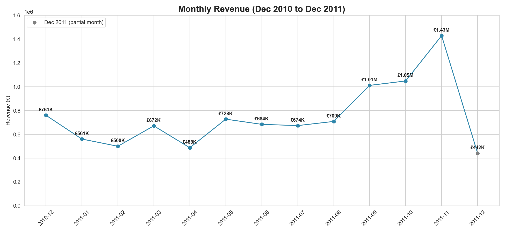
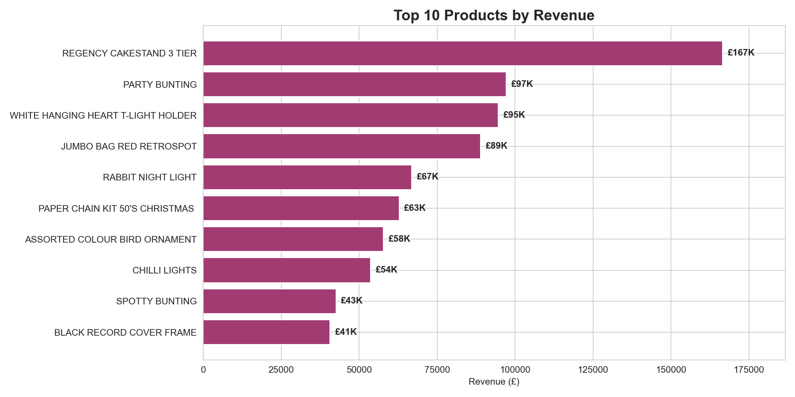
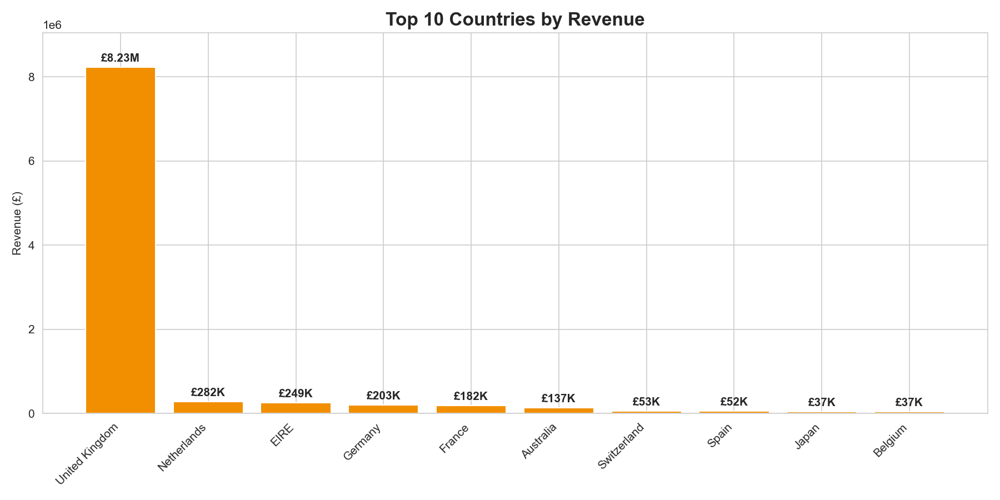

# E-Commerce Sales in the UK Analysis (2010-2011)

Analyzed 541,909 transactions from a UK online retailer to find sales trends, top products, and growth opportunities.



## Key Findings

### 1. Revenue peaks in Q4
- **Total revenue:** about £9.71M over 13 months
- **November 2011:** highest month at about £1.43M, 1.9x the average full month (£772K)
- **Recommendation:** Build inventory and marketing spend ahead of Q4

Note: December 2011 only covers data through Dec 9, so it's shown in gray and left out of the averages.

### 2. Home decor and gifts lead product sales
- **REGENCY CAKESTAND 3 TIER** is the top product at about £167K
- **PARTY BUNTING** (£97K) and **WHITE HANGING HEART T-LIGHT HOLDER** (£95K) follow
- **Recommendation:** Expand the home decor and gift catalog



### 3. Sales are heavily concentrated in the UK
- **UK share:** 84.7% of revenue (about £8.23M)
- **Next markets:** Netherlands (£282K), EIRE (£249K), Germany (£203K)
- **Recommendation:** Test growth in existing European markets first



## Data Cleaning

The raw data includes rows that aren't real product sales. I checked for these before analyzing:

| Issue | Rows | What I did |
|---|---|---|
| Cancelled invoices (InvoiceNo starts with "C") | 9,288 | Removed |
| Zero or negative quantity | 10,624 | Removed (mostly the same rows as cancellations) |
| Zero or negative price | 2,517 | Removed |
| Non-product codes (postage, bank fees, Amazon fees, manual adjustments) | 2,916 | Removed |
| Original orders that were later cancelled | 7,371 | Removed |
| Missing CustomerID | 135,080 | Kept, since this analysis is at the product and country level |
| Partial final month (data ends Dec 9, 2011) | n/a | Shown but left out of averages |

After cleaning, 520,418 rows remain (about 96% of the raw data). Some issues overlap, so the row counts above don't add up to the total removed.

**Why this matters:** My first pass had "DOTCOM POSTAGE" as the top product. It's a shipping fee, so I filtered out non-product codes. After that, two items still looked off: PAPER CRAFT, LITTLE BIRDIE and MEDIUM CERAMIC TOP STORAGE JAR. Each came from one huge order (tens of thousands of units) that was cancelled right after. Removing the cancellation row wasn't enough, since the original order was still counted. I matched each cancellation back to its original order and removed both.

**Known limitation:** Orders are matched to cancellations by customer, product, and quantity. If a customer placed the same order more than once, more than one row may be removed.

## Tools

- **SQL (SQLite):** first-pass queries (`queries.sql`)
- **Python:** pandas, matplotlib, seaborn
- **Python script:** full analysis and charts (`cleaning.py`)

## How to Run

```bash
git clone https://github.com/lisatran183/uk-ecommerce-sales-analysis
cd uk-ecommerce-sales-analysis
pip install pandas matplotlib seaborn
python cleaning.py
```

The script reads `OnlineRetail.csv.zip` directly and saves charts to `images/`.

## Dataset

- **Source:** [Online Retail Dataset on Kaggle](https://www.kaggle.com/datasets/vijayuv/onlineretail)
- **Period:** December 2010 to December 2011
- **Records:** 541,909 transactions

## Future Improvements

- Customer-level analysis (repeat purchase rate, top customers) using rows with a CustomerID
- One-to-one matching of cancellations to orders
- Year-over-year comparison with additional data